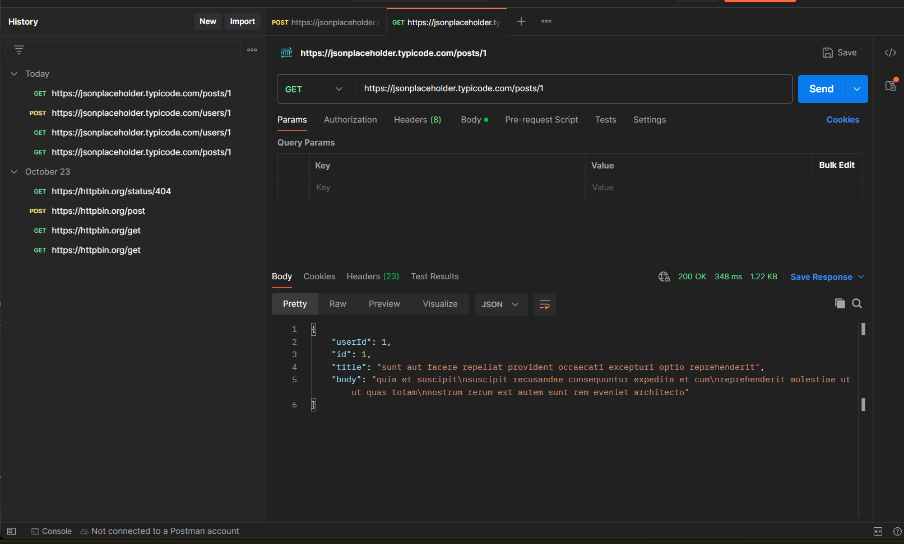
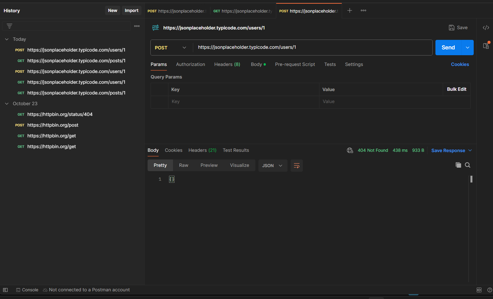

# Backend Task

## Task: Call a Public API using Postman

This task demonstrates calling a public REST API using Postman to test request methods, observe responses, and verify HTTP status codes.

### Public API Details
- **API Provider**: [JSONPlaceholder](https://jsonplaceholder.typicode.com/)
- **Tool Used**: Postman

---

### API Requests & Testing

#### 1. GET Request
- **Method**: `GET`
- **URL**: `https://jsonplaceholder.typicode.com/posts/1`
- **Status**: `200 OK`
- **Description**: Retrieves post details for ID `1`.
- **Screenshot**:
  

#### 2. POST Request
- **Method**: `POST`
- **URL**: `https://jsonplaceholder.typicode.com/users/1`
- **Status**: `404 Not Found`
- **Description**: Demonstrates handling of a POST request to a route that does not accept POST.
- **Screenshot**:
  

---

### Folder Structure
```
backend-task/
├── controllers/
│   └── userController.js
├── middleware/
│   └── errorHandler.js
├── routes/
│   └── userRoutes.js
├── api-testing/
│   ├── get-request.png
│   └── post-request.png
├── package.json
├── server.js
└── README.md
```

---

## Task: In-Memory CRUD API

An Express.js RESTful API implementing full CRUD operations on an in-memory user collection with input validation and centralized error handling.

### How to Run
```bash
npm install
npm start
```
The server will start at `http://localhost:3000`.

### Endpoints

| Method | Endpoint | Description | Request Body | Expected Status |
|---|---|---|---|---|
| `GET` | `/` | Welcome health check | None | `200 OK` |
| `GET` | `/api/users` | Get all users | None | `200 OK` |
| `GET` | `/api/users/:id` | Get user by ID | None | `200 OK` (or `404`) |
| `POST` | `/api/users` | Create new user | `{"name": "...", "email": "..."}` | `201 Created` (or `400`) |
| `PUT` | `/api/users/:id` | Update user by ID | `{"name": "...", "email": "..."}` | `200 OK` (or `400`/`404`) |
| `DELETE` | `/api/users/:id` | Delete user by ID | None | `200 OK` (or `404`) |

### Error Handling Tests
- `GET /api/users/999` -> `404 Not Found` (`User not found`)
- `GET /api/unknown` -> `404 Not Found` (`Route not found`)
- `POST /api/users` with `{}` -> `400 Bad Request` (`Name and email are required`)
- `GET /api/users/abc` -> `400 Bad Request` (`Invalid user ID`)